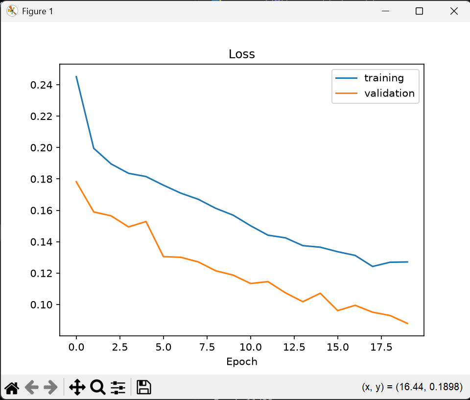

# Links to my LLM chats
- https://claude.ai/share/c9658db5-3291-4e1c-b231-1e8ce229bf60

## First Model
Only used track 1 data, got around track 1 in about 1 minute 50 seconds


```
def train_and_test_model(model, X_train, y_train, X_valid, y_valid):
    print(model.summary())
    history = model.fit(
      batch_generator(X_train, y_train, 100, 1), 
      steps_per_epoch=300, 
      epochs=20, 
      validation_data=batch_generator(X_valid, y_valid, 300, 0), 
      validation_steps=200, 
      verbose=1,
      shuffle=1,
      )
    model.save('basic_augmented_nvidia_model.keras')
    plt.plot(history.history['loss'])
    plt.plot(history.history['val_loss'])
    plt.legend(['training', 'validation'])
    plt.title('Loss')
    plt.xlabel('Epoch')
    plt.show()
    
    
def nvidia_model():
    model = Sequential()
    model.add(Conv2D(24, (5,5), strides=(2,2), input_shape=(66, 200, 3), activation="elu"))
    model.add(Conv2D(36, (5,5), strides=(2,2), activation="elu"))
    model.add(Conv2D(48, (5,5), strides=(2,2), activation="elu"))
    model.add(Conv2D(64, (3,3), activation="elu"))
    model.add(Conv2D(64, (3,3), activation="elu"))
    model.add(Dropout(0.3))
    model.add(Flatten())
    model.add(Dense(100, activation="elu"))
    model.add(Dropout(0.3))
    model.add(Dense(50, activation="elu"))
    model.add(Dropout(0.3))
    model.add(Dense(10, activation="elu"))
    model.add(Dropout(0.3))
    model.add(Dense(1))
    optimizer = Adam(learning_rate = 0.001)
    model.compile(loss='mse', optimizer = optimizer)
    return model
```

## Second Model
The code as first model but with both tracks used to train. Makes it around track 1, and almost makes it around track 2. I think i need to re-record the data for track 2 with smoother turns.
